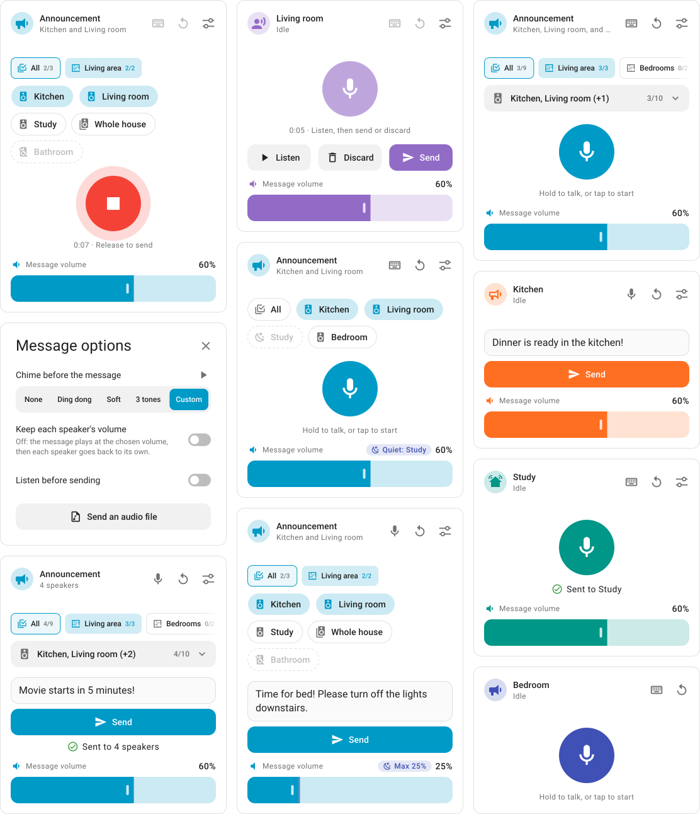

<h1 align="center">HA-nnounce</h1>

<p align="center">
  <strong>Record your voice from your phone or browser,<br>
  and play it on your Home Assistant speakers.</strong>
</p>

<p align="center">
  <a href="https://hacs.xyz/docs/faq/custom_repositories"></a>
  <a href="https://www.home-assistant.io/"></a>
  <a href="LICENSE"></a>
</p>

HA-nnounce turns your Home Assistant media players into a whole-home announcement system. Record a voice message from your phone or browser, choose where it should play, and send it to one or more speakers.

**Choose the speakers, hold the microphone button, talk, and release to send.**

Messages are processed locally: audio travels from your device to Home Assistant, then from Home Assistant to the selected speakers. No external cloud service is involved.

<picture>
  <source media="(prefers-color-scheme: dark)" srcset="docs/images/wall-dark.svg">
  
</picture>

### Features

- **Announcements panel:** a dedicated sidebar panel designed for quick access from your phone.
- **Dashboard card:** `custom:hannounce-card`, with a visual configuration editor and support for English and Italian, light and dark themes.
- **Two-way audio intercom (Labs):** turns every supported speaker into an intercom camera using Home Assistant's native Start talking interface.
- **Automation actions:** send an existing audio file or URL with `hannounce.announce`, or replay the last message with `hannounce.replay`.
- **Playback management:** optional chimes, configurable announcement volume and automatic restoration of each speaker's volume.
- **Audio processing:** automatic silence trimming and EBU R128 loudness normalization.
- **Media history:** announcements remain available in the Media panel for one hour.

## Supported speakers

HA-nnounce works with Home Assistant `media_player` entities. It needs no brand-specific code: it relies on the speaker's own Home Assistant integration and delivers announcements through Home Assistant's media playback pipeline.

The integration provides each message as a `media-source://hannounce/...` source, similar to text-to-speech. The speaker integration resolves the source and handles playback on the actual device.

### Compatibility

| Integration | Playback behavior |
|---|---|
| Google Cast (Google Home, Nest, Chromecast and groups) | Plays the announcement as a regular audio source. A Nest Hub displays the title "Announcement". |
| Sonos, Music Assistant, Squeezebox and Bang & Olufsen | Supports announcement mode: music is temporarily lowered, the message plays at its dedicated announcement volume, and playback resumes afterwards. |
| ESPHome (including Home Assistant Voice PE) | Supports announcement mode: music is lowered and resumes after the message. |
| DLNA/UPnP, HEOS, Bluesound, LinkPlay, WiiM, Yamaha MusicCast, SoundTouch, OpenHome, MPD, VLC, Kodi, Apple TV, forked-daapd, Fully Kiosk, UniFi Protect, Roku, Dune HD and Panasonic Viera | Plays the message as a regular audio track. |
| Custom integrations (such as Browser Mod) | Receives a signed audio URL. These players can be added manually in the integration options. |

**Limitations:** players that cannot play an audio file from a URL, including Alexa/Echo and Spotify, are not supported.

Compatibility has been tested with Home Assistant 2026.11.1 and simulated media players. Real-world playback has not yet been verified on speakers from every listed integration.

### Google Home and Google Cast

Google Home speakers are supported through Home Assistant's Google Cast integration. There is no need to use Google's cloud services or configure a separate Google Assistant integration.

| Approach | Supported | Details |
|---|---|---|
| Home Assistant + Google Cast | **Yes, recommended** | Every Google Home speaker is a Cast device. Home Assistant can discover it through the Google Cast integration and play audio files served directly by Home Assistant. |
| Google Assistant / Google Home cloud APIs | No, for recorded audio | The Google Assistant broadcast feature, including the Google Assistant SDK integration, only accepts text that is read aloud using text-to-speech. There is no public Google API for playing arbitrary recorded audio files on a speaker. |
| Direct local Google Cast | Yes, but unnecessary | Uses the same local Cast protocol as the Home Assistant integration. A speaker configured through the Google Home app is already a Cast device on the network; Home Assistant simply needs to discover it. |

## How it works

HA-nnounce uses Home Assistant's native media playback infrastructure, with a local audio processing pipeline.

```text
  Phone or browser             Home Assistant                 Speaker
  ----------------             --------------                 -------

  Card or panel
  MediaRecorder
       |
       |  Recorded audio
       v
                                POST /api/hannounce/announce
                                        |
                                        v
                                ffmpeg processing:
                                - silence trimming
                                - loudness normalization
                                - chime insertion
                                - MP3 encoding
                                        |
                                        v
                                media_player.volume_set
                                media_player.play_media
                                        |
                                        | media-source://hannounce/<id>.mp3
                                        v
                                                              Integration resolves
                                                              the media source
                                                                      |
                                                                      v
                                                              Speaker downloads
                                                              the MP3 from a
                                                              signed local URL
                                        |
                                        v
                                Waits for playback to finish
                                and restores the volume


  iOS app / Start talking
  (Labs two-way audio)
       |
       | WebRTC
       v
                                Intercom camera (aiortc)
                                        |
                                        | When recording stops
                                        v
                                Same announcement pipeline
```

The integration handles recording uploads, audio processing, media source generation, playback coordination and volume restoration. Speakers only need to support audio playback through their Home Assistant integration.

## Requirements

- **Home Assistant 2026.11 or later.** Tested with 2026.11.1.
- The Home Assistant integration for your speakers (Google Cast, Sonos, ESPHome, etc.).
- **A local URL reachable by your speakers.** Configure it in Settings > System > Network. For example:

  ```text
  http://192.168.1.10:8123
  ```

  Speakers download the audio directly from this address. Self-signed HTTPS certificates are not supported; use local HTTP or HTTPS with a valid certificate.

- **ffmpeg**, already included in Home Assistant OS and the official Home Assistant container.

## Installation

### HACS

1. Open HACS and navigate to the menu.
2. Select **Custom repositories**.
3. Add the URL of this repository and select **Integration** as the category.
4. Find and install **HA-nnounce**.
5. Restart Home Assistant.

### Manual installation

Copy the `custom_components/hannounce` directory into:

```text
config/custom_components/
```

Then restart Home Assistant.

### Set up the integration

After installation:

1. Open Settings > Devices & services.
2. Select **Add integration**.
3. Search for **HA-nnounce** and complete the setup.

## Configuration

HA-nnounce provides the following options under the integration configuration.

| Option | Default | Description |
|---|---|---|
| Speakers | All supported speakers | Select which media players are available. Leaving this empty includes all players from supported integrations, excluding televisions. Select players manually to include custom integrations or restrict the available speakers. |
| Set the volume for messages | On | Temporarily sets the speaker volume to the announcement volume and restores it afterwards. If someone changes the volume during playback, their new volume is preserved. |
| Message volume | 60% | Default playback volume. It can also be adjusted for individual announcements from the card or panel. |
| Use the announcement volume of the speaker | On | Uses the speaker's dedicated announcement volume, when supported. Available for Sonos, Music Assistant, Squeezebox and Bang & Olufsen. Music volume is not changed. |
| Chime before the message | Ding dong | Select the sound played before an announcement: None, Ding dong, Soft or 3 tones. Chimes are synthesized; no external audio files are required. |
| Even out the loudness | On | Applies EBU R128 loudness normalization so that quiet and loud recordings play at a consistent perceived volume. |
| Longest message | 60 seconds | Maximum recording duration. Recording stops automatically when this limit is reached. |
| Show Announcements in the sidebar | On | Enables the dedicated Announcements panel in the Home Assistant sidebar. |
| Intercom cameras (Labs two-way audio) | Off | Creates intercom cameras for the selected speakers. Enabling this option installs `aiortc` on first use. |

## Using HA-nnounce

HA-nnounce can be used in two ways: through the dedicated Announcements panel or directly from a Home Assistant dashboard using the custom card.

### Dashboard card and Announcements panel

Both interfaces share the same core recording and playback workflow.

1. **Select the speakers** that should receive the message. Your selection is remembered locally on the device.
2. **Record your message:** hold the microphone button while speaking and release it to send. Alternatively, tap once to start recording and tap again to send. Press `Esc` to cancel.
3. **Adjust the message volume** using the volume slider. After playback, each speaker returns to its previous volume.

Additional controls:

- **Replay:** the circular arrow plays the most recent announcement again, using `hannounce.replay`.
- **Options:** the sliders icon opens the options dialog, where you can configure the chime, keep each speaker's volume, listen before sending and send an audio file. These preferences are stored for the device in use.
- **Open a speaker:** tap the card title when a single speaker is selected. You can also open an individual speaker with a long press or right-click.
- **Error messages:** recording and sending errors show as Home Assistant toast messages, in your language. If a speaker fails to play a message, the error is written to the Home Assistant log.

### Configuring the dashboard card

Add the card through the visual dashboard editor. The editor supports configuring the title, icon, color, speakers and visible controls.

The card can also be configured directly in YAML:

```yaml
type: custom:hannounce-card
title: Kitchen               # Optional
icon: mdi:bullhorn-outline   # Optional
color: deep-orange           # Home Assistant color; primary by default
entities:                    # Optional: speakers to display
  - media_player.kitchen
show_volume: true            # Show the volume slider
show_settings: true          # Show the options button
review: false                # Listen before sending
```

The `review` option enables listening to the recording before sending it. Users can also change this preference through the card options.

The integration serves the card and its resources automatically. **No additional Lovelace dashboard resource needs to be configured.**

The interface supports light, dark and custom Home Assistant themes, English and Italian, and the number format selected in the user's profile.

When a card's title is the name of its only selected speaker, the card shows that speaker's state, similarly to a native Home Assistant tile card.

### Intercom with two-way audio (Labs)

Home Assistant 2026.11 introduced two-way audio for cameras through Labs. This feature allows the native **Start talking** button on a camera to transmit microphone audio over WebRTC.

HA-nnounce uses this capability to turn speakers into intercom endpoints.

#### Setup

1. Enable **Intercom cameras** in the HA-nnounce integration options. HA-nnounce creates an intercom camera for each speaker, as well as a shared **Intercom All speakers** camera.
2. Open Settings > System > Labs.
3. In the Camera section, enable **Two-way audio**. The intercom cameras get the **Start talking** button.

#### Using the intercom

Open an intercom camera and press **Start talking** to begin transmitting audio. Press **Stop talking** to finish.

The recorded message is sent through the same announcement pipeline used by the card and panel as soon as transmission stops.

The camera video provides visual feedback, including the recording state and microphone level, sending progress and delivery status.

The WebRTC connection is handled directly by the integration using [aiortc](https://github.com/aiortc/aiortc), without requiring go2rtc.

### Microphone access, HTTPS and mobile apps

Browser microphone access requires a secure context. This means HTTPS is normally required when accessing Home Assistant from another device.

The following combinations are supported:

| Environment | Microphone access |
|---|---|
| Browser over HTTPS (or `localhost`) | Supported in the card, panel and intercom. |
| Browser over HTTP | Not available for direct recording. You can still send an audio file recorded on your phone. |
| iOS app 2026.10.3 or later over HTTP | Supported with the intercom enabled. The app hands the microphone to the intercom, including when accessed through the card or panel. Not yet tested on a physical iPhone. |
| Android app over HTTP | Not yet supported. Microphone hand-off is still in development; HTTPS is required. |

## Automations and services

HA-nnounce exposes two actions for use in Home Assistant automations and scripts.

### `hannounce.announce`

Sends an existing audio file or URL to one or more media players.

```yaml
action: hannounce.announce
data:
  entity_id:
    - media_player.kitchen
  file: /media/messages/dinner.mp3
  volume: 50
  chime: soft
```

The example sends a local audio file to the kitchen speaker, using a message volume of 50% and the Soft chime.

Local files must be located in a directory included in Home Assistant's `allowlist_external_dirs`.

### `hannounce.replay`

Replays the most recent announcement on the selected speakers. Without `entity_id`, it plays on the speakers of the last message.

```yaml
action: hannounce.replay
data:
  entity_id: media_player.bedroom
```

### Events

Every announcement triggers the `hannounce_announced` event.

The event includes the following data:

| Field | Description |
|---|---|
| `id` | Unique identifier of the announcement. |
| `targets` | Media players targeted by the announcement. |
| `duration` | Duration of the played audio in seconds, chime and short pauses included. |
| `source` | Origin of the announcement: `upload`, `intercom` or `service`. |
| `user_id` | Home Assistant user who sent the announcement. Empty for intercom messages. |

The event can be used to trigger additional automation logic, for example to coordinate other devices when a message is sent.

## Playback behavior and limitations

A few aspects of media playback depend on the capabilities of the underlying speaker integration.

### Music interruption and volume restoration

- **Google Home:** currently, music stops when an announcement is played and does not resume automatically. This is a limitation of Google Cast. The speaker volume is restored afterwards.
- **Announcement mode:** Sonos, ESPHome, Music Assistant and other supported implementations can lower the music volume, play the message and resume playback afterwards.
- **Volume restoration:** the original volume is restored after playback. If someone changes the volume while the message is playing, the new volume is preserved.

### Multiple speakers and synchronization

When selecting several speakers individually, playback starts at approximately the same time, but the audio is not synchronized between devices.

For synchronized playback, use a speaker group instead:

- Google Home speaker groups.
- Sonos groups.
- Home Assistant media player groups.

A group is presented as a single speaker in HA-nnounce and allows the underlying integration to handle synchronization.

### Message storage and expiration

Announcements are stored temporarily for playback history and replay functionality.

- Audio files remain available for **one hour**.
- After that period, they are automatically deleted.
- Temporary messages are not included in Home Assistant backups.
- The link speakers receive stops working within one hour, when the audio is deleted.

## Privacy

HA-nnounce processes and delivers audio entirely within your home network.

Recordings travel from your phone or browser to Home Assistant, where they are processed before being delivered to the selected speakers.

**No external cloud service is involved, and audio is not sent to third-party services.**

## Development

See [tools/README.md](tools/README.md) for details.

- **Backend tests:** `pip install -r requirements_test.txt`, followed by `pytest`. The suite uses the official `pytest-homeassistant` package and currently contains 33 tests, with approximately 90% coverage.
- **Frontend tests:** `node --test tools/tests` for the card's standalone helpers.

## License

HA-nnounce is released under the [MIT License](LICENSE).
